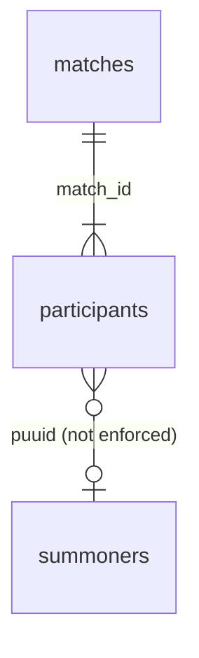

# ARAM-S-Tracker Data Model

Columnar storage using Parquet files tracked in Git LFS. The same files are read by the Electron app (DuckDB on local disk) and by the GitHub Pages build (DuckDB-WASM over HTTP range requests).

The machine-readable definition lives in `aram_schema.py`; this document describes the same model.

## Overview

| Table | Category | Primary key | Partitioned by | Written by |
|---|---|---|---|---|
| `matches` | Fact | `match_id` | `patch` | Ingest (append) |
| `participants` | Fact | `match_id`, `puuid` | `patch` | Ingest (append) |
| `summoners` | Dimension | `puuid` | None (single file) | Ingest (replace) |



## File layout

```
data/
├── matches/patch=26.22/part-<utc>-<id>.parquet
├── participants/patch=26.22/part-<utc>-<id>.parquet
├── summoners.parquet
└── manifest.json
```

**Fact tables** are append-only. Each ingest run writes one new part file per patch and never edits existing files, which keeps Git LFS storage growth to the new data only. When a patch ends, its part files are compacted into a single sorted file.

**Dimension tables** are a single file, replaced whole when they change.

**File settings:** zstd compression, row groups of 100,000 rows, dictionary encoding, column statistics on. Target 10 to 100 MB per file. Never one file per match.

## Fact tables

### `matches`

One row per match.

| Column | Type | Nullable | Description |
|---|---|---|---|
| `match_id` | string | No | Riot match id, e.g. `NA1_5123456789` |
| `region` | string | Yes | Routing region; falls back to the `match_id` prefix |
| `patch` | string | No | Major.minor patch, e.g. `26.22`. Partition key. `unknown` if not recorded |
| `game_creation` | timestamp[ms, UTC] | Yes | Game creation time |
| `game_date` | date | Yes | UTC date of `game_creation`; used for pruning |
| `game_duration` | int32 | Yes | Duration (seconds) |
| `game_mode` | int32 | Yes | Integer game mode code |
| `ingested_at` | timestamp[ms, UTC] | Yes | When the match was recorded |

Sorted by `game_creation`, `match_id`.

### `participants`

One row per player per match.

| Column | Type | Nullable | Description |
|---|---|---|---|
| `match_id` | string | No | Foreign key to `matches.match_id` |
| `puuid` | string | No | Player key (hashed in the public build) |
| `patch` | string | No | Denormalized from `matches`; partition key |
| `game_date` | date | Yes | Denormalized from `matches` |
| `champ_id` | int32 | No | Champion id |
| `team_id` | int16 | Yes | 100 or 200 |
| `win` | bool | Yes | Whether the player's team won |
| `kills` | int16 | Yes | |
| `deaths` | int16 | Yes | |
| `assists` | int16 | Yes | |
| `pentakills` | int16 | Yes | |
| `total_damage_dealt` | int32 | Yes | |
| `magic_damage` | int32 | Yes | |
| `physical_damage` | int32 | Yes | |
| `true_damage_dealt` | int32 | Yes | |
| `total_damage_taken` | int32 | Yes | |
| `damage_self_mitigated` | int32 | Yes | |
| `damage_to_objectives` | int32 | Yes | |
| `gold_earned` | int32 | Yes | |
| `total_heal` | int32 | Yes | |
| `time_cc_others` | float32 | Yes | |
| `items` | list&lt;int32&gt; | Yes | Item id by slot index; `0` = empty slot |
| `augments` | list&lt;int32&gt; | Yes | Augment id by slot index; empty list for games without augments |

Sorted by `champ_id`, `game_date`, `match_id`, so champion-filtered queries skip most row groups.

**List columns:** `items` and `augments` replace separate child tables. The list index is the slot number, and slots with no item are filled with `0`. To query across items, unnest the list, for example in DuckDB:

```sql
SELECT champ_id, UNNEST(items) AS item_id, win
FROM participants
WHERE patch = '26.22';
```

## Dimension table

### `summoners`

| Column | Type | Nullable | Description |
|---|---|---|---|
| `puuid` | string | No | Player key (hashed in the public build) |
| `summoner_name` | string | Yes | Null in the public build |
| `tagline` | string | Yes | Null in the public build |
| `region` | string | Yes | |
| `updated_at` | timestamp[ms, UTC] | Yes | When the row was last written |

## Computing stats at query time

There are no precomputed stats tables. Champion, item and augment statistics are computed on demand with DuckDB, which reads only the columns each query needs and prunes by `patch`.

Champion win rate and pick rate for a patch:

```sql
SELECT
  champ_id,
  COUNT(*)                                   AS games,
  SUM(win::INT)                              AS wins,
  AVG(win::INT)                              AS winrate,
  COUNT(*) * 1.0 / SUM(COUNT(*)) OVER ()     AS playrate
FROM participants
WHERE patch = '26.22'
GROUP BY champ_id;
```

Item stats for a champion (the same pattern works for `augments`):

```sql
SELECT item_id, COUNT(*) AS games_played, AVG(win::INT) AS winrate
FROM (
  SELECT DISTINCT match_id, puuid, champ_id, win, UNNEST(items) AS item_id
  FROM participants
  WHERE patch = '26.22' AND champ_id = 103
)
WHERE item_id <> 0
GROUP BY item_id;
```

For all-time figures, drop the `patch` filter, or sum `games` and `wins` across patches and recompute the rates. Rates are not additive, so never average them.

If a page later proves slow, precomputed per-patch stats tables can be added without changing anything above.

## Manifest

`data/manifest.json` lists every file so the static front end never needs directory listing (which GitHub Pages does not provide).

```json
{
  "schema_version": 1,
  "generated_at": "2026-11-23T12:00:00+00:00",
  "cursor": {},
  "tables": {
    "participants": {
      "category": "fact",
      "partition_by": "patch",
      "primary_key": ["match_id", "puuid"],
      "files": [
        {
          "path": "participants/patch=26.22/part-20261120T120000-ab12cd34.parquet",
          "patch": "26.22",
          "rows": 120000,
          "bytes": 4200000,
          "sha256": "..."
        }
      ]
    }
  }
}
```

`cursor` holds ingest progress (for example the last processed match time), replacing the old queue-style state.

## Integrity rules

Checked in CI by `validate()`:

1. Primary keys are unique in every table.
2. Columns marked non-nullable contain no nulls.
3. Every `participants.match_id` exists in `matches`.

`participants.puuid` is not required to exist in `summoners`.

## Writing rules

- **Dedupe before append.** Ingest drops rows whose primary key already exists before writing a new part file.
- **Atomic writes.** Write to a temporary file, then rename.
- **One writer at a time.** Use a single scheduled workflow with a concurrency group.
- **Never rewrite fact partitions during normal ingest.** Only compaction, once per finished patch, rewrites them.

## Public build

The GitHub Pages dataset is published with:

- `puuid` replaced by a salted SHA-256 hash (first 32 hex characters) in `participants` and `summoners`
- `summoner_name` and `tagline` set to null

The salt is kept as a repository secret and never committed.

## Assumptions to verify

- `game_duration` is in seconds and `game_creation` is UTC.
- `total_damage_dealt` means the same thing it did before (damage to champions versus total damage); the front end labels it.
- Item id `0` is only ever an empty slot, never a real item.
- The query-time stats above define `playrate` as games divided by all participant rows in the patch; confirm this matches what the app displays today.
